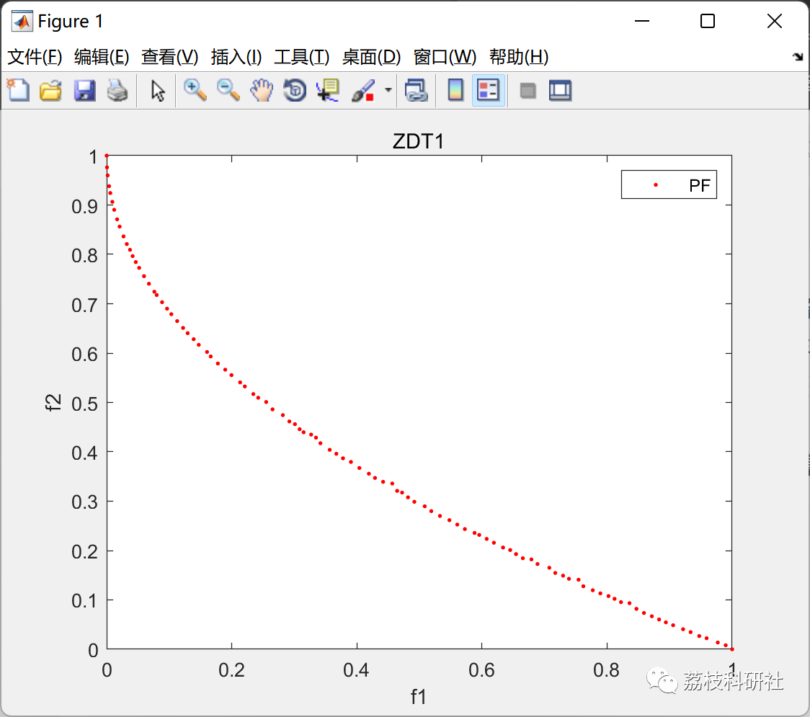

# Multi-Objective Optimization Algorithm MOAHA: Multi-Objective Artificial Bee Colony Algorithm (Matlab Code Implementation)

💥💥💥💞💞💞💞 Welcome to this blog❤️❤️❤️💥💥💥
🏆 Bloggers' Advantage: 🌞🌞🌞 The content of the blog strives to be rigorous in thought and clear in logic, for the convenience of readers.
⛳️ Mantra: The journey of a hundred miles is half done in the last ninety.
Litchi Research Society
Code Collection: Power System, Intelligent Algorithms and Applications, Neural Network Prediction, Path Planning, Optimized Scheduling, Workshop Scheduling, Image Processing, Signal Processing...
🎁Column Directory Link:
🌈🌈🌈🌟🌟🌟🛫🛫🛫🛫🛫🛫🛫🛫🛫🛫🛫🛫🛫🛫🛫🛫🛫🛫🛫🛫🛫🛫🛫🛫🛫🛫🛫🛫🛫🛫🛫🛫🛫🛫🛫🛫🛫🛫🛫🛫🛫🛫🛫🛫🛫🛫🛫🛫🛫🛫🛫🛫🛫🛫🛫🛫🛫🛫🛫🛫🛫🛫🛫🛫🛫🛫🛫🛫🛫🛫🛫🛫🛫🛫🛫🛫🛫🛫🛫🛫🛫🛫🛫🛫🛫🛫🛫🛫🛫🛫🛫🛫🛫🛫🛫🛫🛫🛫🛫🛫🛫🛫🛫🛫🛫🛫🛫🛫🛫🛫🛫🛫🛫🛫🛫🛫🛫🛫🛫🛫🛫🛫🛫🛫🛫🛫🛫🛫🛫🛫🛫🛫🛫🛫🛫🛫🛫🛫🛫🛫🛫🛫🛫🛫🛫🛫🛫🛫🛫🛫🛫🛫🛫🛫🛫🛫🛫🛫🛫🛫🛫🛫🛫🛫🛫🛫🛫🛫🛫🛫🛫🛫🛫🛫🛫🛫🛫🛫🛫🛫🛫🛫🛫🛫🛫🛫🛫🛫🛫🛫🛫🛫🛫🛫🛫🛫🛫🛫🛫🛫🛫🛫🛫🛫🛫🛫🛫🛫🛫🛫🛫🛫🛫🛫🛫🛫🛫🛫🛫🛫🛫🛫🛫🛫🛫🛫🛫🛫🛫🛫🛫🛫🛫🛫🛫🛫🛫🛫🛫🛫🛫🛫🛫🛫🛫🛫🛫🛫🛫🛫🛫🛫🛫🛫🛫🛫
💥1 Overview
📚2 Running Results
🎉3 References
👨‍💻4 Matlab code implementation
💥1 Overview
The Artificial Bee Colony (AHC) algorithm, a recently developed bio-inspired metaheuristic, exhibits excellent performance in addressing single-objective optimization problems. Despite its merits, the algorithm can only solve one objective problem. To tackle complex multi-objective optimization problems, including engineering design issues, this study develops a Multi-Objective AHC (MOAHC). In MOAHC, an external archive is utilized to store Pareto-optimal solutions, and a dynamic elimination of crowded distance (DECD) method is developed to maintain the archive effectively to protect population diversity. Furthermore, by integrating the non-dominated sorting strategy with MOAHC, a mechanism for solution update is constructed, effectively refining the Pareto-optimal solutions and enhancing the convergence of the algorithm. On the convergence, diversity, and solution distribution aspects, the superior results of 7 competitors are demonstrated on 28 benchmark functions through a comprehensive set of tests. The MOAHC algorithm is also applied to 5 real-world engineering design problems with multiple objectives, proving its advantages in handling challenging real-world multi-objective problems with unknown true Pareto-optimal solutions and frontiers.
📚2 Running Results
🎉3 References
[1]W. Zhao, Z. Zhang, S. Mirjalili, L. Wang, N. Khodadadi, S. M. Mirjalili. An effective multi-objective artificial hummingbird algorithm with dynamic elimination-based crowding distance for solving engineering design problems, Computer Methods in Applied Mechanics and Engineering, (2022), 115223  
👨‍💻4 Matlab code implementation
Click the "Read More" button at the bottom left of the article.

## Images

<!-- PAYMENT_BLOCK -->

## Get this dataset

- Payment link (Stripe): [Buy now](https://buy.stripe.com/3cs8yP7sY87d0vu9AB)
- Payment QR code: 

<!-- /PAYMENT_BLOCK -->
